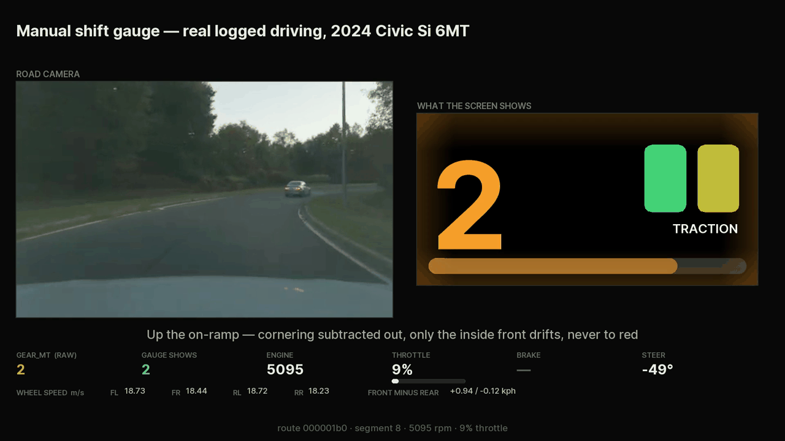
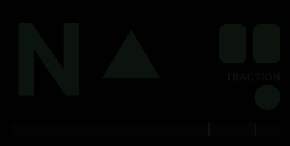
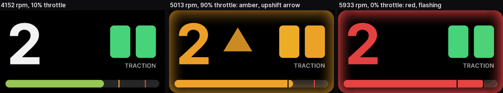
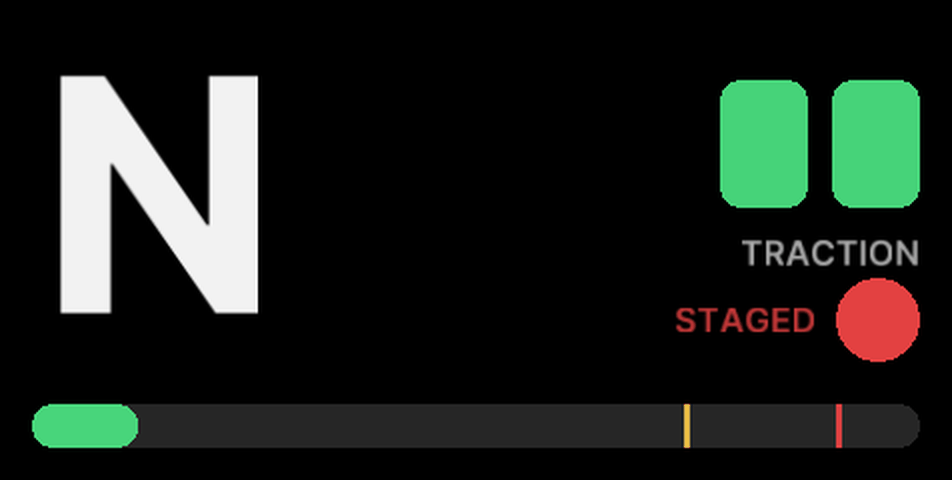
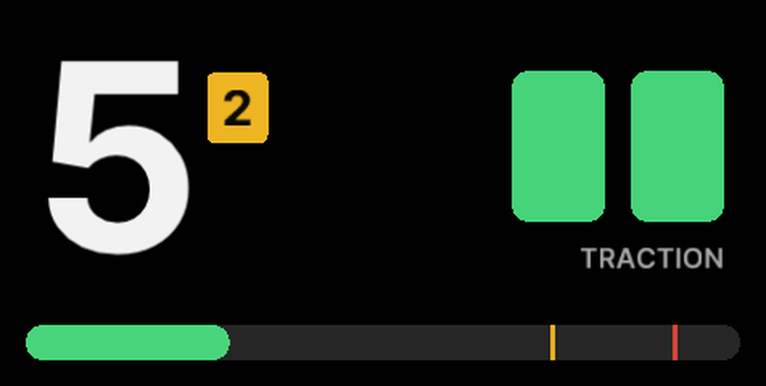
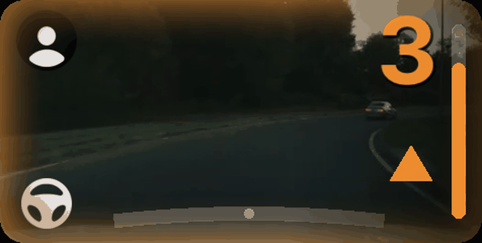

# Civic Si (6MT) on sunnypilot

A [sunnypilot](https://github.com/sunnypilot/sunnypilot) branch for a 2024 Honda Civic Si with the
six-speed manual, running on a comma 4.

openpilot assumes an automatic. On a manual car it spends a 536×240 screen on a camera feed you are
never looking at, and several of its control paths quietly fight a driver who owns the clutch. This
branch turns that screen into a shift light and fixes those paths.

Everything below was validated by replaying real logged drives through the actual widget code, not
by inspection. Where a number appears it came from a measurement unless it says otherwise, and the
things that measured badly were thrown away ([below](#measured-and-dropped)).



---

## The gauge

`selfdrive/ui/sunnypilot/onroad/manual_gauge.py`

Gear on the left, shift hint in the middle, traction on the right, engine speed along the bottom.
Green to 4800 rpm, amber from there, red at 5900 against a 6500 redline. A line across the bar marks
4800 and 5900, drawn in the color it switches to until the fill reaches it and a dark cut after, so
the shift point is visible before the color changes.



Every element sweeps once at startup, so a dead one is obvious before you pull out.



A real second-gear pull (route `1b1`, segment 31), drawn by the gauge code itself from the logged
values.

### Deriving the gear

The car does publish a gear. It is just not trustworthy. `GEARBOX_ALT_2.GEAR_MT` is labeled
**Clutch** in `honda_bosch_radarless.dbc`, and it works by ratio-matching engine speed against wheel
speed. Two consequences:

- With the clutch in, a decaying engine sweeps the signal up through 4, 5, 6 as it falls.
- At 21 mph, idle (849 rpm) is almost exactly what sixth demands (846 rpm), so it parks on "6" and
  stays there for as long as you coast.

So the gauge re-derives the gear from rpm against wheel speed with a 3% ratio tolerance, and refuses
to believe any gear while the engine is at idle above 12 mph with the throttle shut. That cut
wrong-gear display from **30.6s to 6.1s** over a test drive. Holding through a shift for 2.0s instead
of reacting instantly cut neutral flashes from **53 to 29**.

### Traction

`carstate.py` was averaging all four wheel speeds into one number and discarding the individual
wheels. On a front-wheel-drive car the undriven rear pair is a free ground-speed reference, so the
branch keeps them and measures each front wheel against it, subtracting the speed difference that
cornering alone accounts for (1.54 m track, bicycle model). What is left is wheelspin: amber at
1.0 kph, red at 2.5.

Below 3 m/s the wheels are not compared, because the wheel sensors give way first (see
[below](#measured-and-dropped)). Stopped or crawling, the panel stays green unless a front is turning
more than 5 kph faster than the rears, which a spin off the line does and nothing else in the logs did.

Subtracting cornering is the whole point. Up an on-ramp at 52° of lock the outer front reads 0.45
kph and the inner front 1.06 kph, so the panel tints one wheel and not the other, which is an open
differential leaning on the unloaded side rather than a turn being mistaken for slip.

### Green-light watch



Stopped at a light, a dot sits by the traction panel under a `STAGED` label, turns amber once the
way ahead opens, and goes green when sunnypilot's own green-light or lead-departure alert fires. It
is a readout of an existing signal, not a new detector. It runs the same rules as that watch, with
the same two settings toggles, so amber means the chime is 0.3 s out.

An earlier version guessed at those rules. Over 15 logged stops it went amber 7 times with only 3
chimes following: parked before the drive's first move, which sunnypilot never arms on, and a car
that pulled in close after the stop, which it never watches. Green only ever comes from the planner,
so if `plannerd` is down the dot sits on amber instead of faking a green. That is how the `ShiftAlert`
crash showed on the road.

### Optimal gear



In any gear taller than the optimal one, a yellow box beside the numeral names the gear to drop to:
2nd here, in 5th at 38 mph. It only ever points down, holds through the clutch so it does not blink
off mid-downshift, and clears once you are in that gear. Lugging the engine, it blinks, taking over
from the old downshift arrow.

The bands are modeled, not measured, because the logs hold under a second of full throttle. A
full-throttle simulation on Honda's published curve (192 lb-ft from 1800 to 5000 rpm, 200 hp at 6000),
the measured gear ratios and a 0.4 s shift gives the gear a 15 mph pull is quickest in: 1st below 18
mph, 2nd below 42, 3rd below 69, 4th below 95. That is not the lowest gear under the red line. 2nd at
48 mph lands at 5900 and runs out before the downshift pays for itself, so each band leaves 800 to
1350 rpm to pull. Shift time moves the edges most, about 3 mph either way between 0.3 and 0.5 s.

### Steering-only



With MADS steering (the cyan border) you are still on the clutch and the shifter, so the gauge stays,
moved to the right edge with the camera back: a vertical rev bar, the numeral, the shift arrows and
the optimal-gear box. It used to disappear in this mode while the shift beeps kept sounding.

### Cost

The full gauge covers the screen, so rendering the camera and the model underneath it is wasted work.
Skipping both while it is up took the UI from **62.3% to 48.9% of one core**, measured by commit hash
with the controls flat. In steering-only mode the camera is drawn as normal.

---

## Sound

`sunnypilot/selfdrive/controls/lib/shift_alert_helper.py`, `selfdrive/assets/sounds/`

Three beeps through the amber band at 4800 / 5150 / 5500 rpm, then a held tone at 5900. Each mark
re-arms only after the revs drop 250 rpm below it, and arriving already above a mark spends it
silently, so squeezing the throttle at 5100 does not beep for a line you passed a minute ago. The cue
only runs while you are driving the car yourself, above 15% throttle, in gears 1 through 5.

The tone is not invented. A Type R shift chime was pulled from video and measured at **1333 Hz**,
essentially a pure sine (second harmonic 23.8 dB down). 48000 and 1333 are coprime, so 1333 cycles is
exactly 1.000 s, which is the shortest seamless loop at that pitch. The rest of the alert palette was
re-tuned to clear the comma 4 speaker's low-frequency rolloff, and the volume curve was recalibrated:
the stock mapping assumes a louder mic than the comma 4 has, and mapped a measured 27-43 dB cabin to
9-37% volume, which is inaudible at speed.

### Two bugs in `soundd` that are not specific to this car

Both affect **every looping alert in openpilot, the collision warning included**:

- **Volume stepped, not ramped.** Gain was applied as one scalar per 4096-sample block while
  `current_volume` updates at 20 Hz, so the waveform jumped at every block boundary. Under the comma 4
  tuning a 3 dB gust of road noise moved gain by 0.17, a larger discontinuity than anything inside the
  wav files. Now interpolated across the block.
- **Loops replayed their own tail.** The read offset was computed once outside the `while` loop, so a
  file that wrapped part way through a block took its second pass from the same stale offset and
  copied the tail twice. Audible as a stutter at every loop point, on any sound whose length is not a
  multiple of the block.

These two are worth upstreaming on their own.

---

## Control changes

Mostly about not fighting a driver who has a clutch pedal.

- **Hand longitudinal off while the clutch is disconnected.** Gas was already blocked. Brake was
  tried too and removed: openpilot's rate-limited brake lingers and resists as you ease the clutch
  back out. You are already on the brake pedal when you clutch in to stop, so the driver owns the
  stop.
- **Yield on override.** With hands on the wheel, steering torque ramps to zero over 0.3 s so the car
  lets go instead of fighting, then back over 0.7 s when you let go. Lateral stays engaged throughout.
- **`STEER_THRESHOLD` 1200 to 600** for `HONDA_CIVIC_2022`, so the override above actually triggers at
  the torque this car's sensor reports.
- **Blinker-pause timer ran at double speed.** `get_lat_active()` drives that countdown and was being
  called twice per control cycle, once in `state_control` and once in `publish`. Now evaluated once
  and cached.
- **A chime when lateral quietly resumes** after a blinker pause, armed only on a real mid-engagement
  drop so a fresh engage stays silent.
- **`torqueBP` stays at 4096.** Raising it to 6144 was tried on-road and reverted. CAN carried the
  full 6144, but the learned `latAccelFactor` moved 1.97 to 2.09, a 6% result for a 50% larger
  command, then plateaued: the EPS ignores most of it. The cost was real, because `STEER_DELTA_UP`
  applies to the normalized request, so a larger ceiling slews absolute torque proportionally faster.
  That produced ~1.5 Hz hunting at 6.3° angle standard deviation. The reasoning is left in
  `interface.py` so nobody retries it.

---

## Measured and dropped

The useful half of the work.

| Idea | Result | Verdict |
|---|---|---|
| Only accept a gear change after a clutch press | Removed **0.0 s** of 33.6 s of wrong-gear display. Phantom gears arrive through the clutch too. | dropped |
| Predict the rev-match target for the next gear down | **52%** accurate. | dropped |
| Show coolant temperature | The signal decoded to physically impossible values (184 °C). | reverted |
| Raise `torqueBP` to 6144 | +6% authority for a +50% command, plus 1.5 Hz hunting. | reverted |
| Compare the wheels down to a crawl | The sensors wake one at a time as the car starts to roll, each reading ~2 kph while the rest read 0, and parking-lot lock puts the cornering model 2.4 kph off. **1.7 s of amber per 44 min, none of it spin.** | dropped below 3 m/s |
| Read a slip event off a 63° steering lock | 4.38 kph peak, but only 0.06 s above threshold. The bicycle model breaks down past ~150°. | rejected as artifact |

Three process notes that cost real time:

- **A test can encode the same wrong assumption as the code.** The shift arrows never drew, because
  raylib backface-culls `draw_triangle` and they were wound the wrong way. 106 tests passed, because
  the test asserted the same incorrect sign. It now measures the winding of a triangle that provably
  renders and compares against that.
- **A condition can be unreachable and still look correct.** The downshift hint required more than 8%
  throttle below 1200 rpm. The highest throttle at any such moment across the logs was **2.4%**, so it
  could never fire. Found by replaying drives, not by reading the code.
- **qlogs are decimated.** Single-frame events are dropped from them, so "this alert never fires" is
  not a conclusion you can draw from a qlog. Sparse events need full-rate rlogs.

---

## Layout of the changes

| Path | What |
|---|---|
| `selfdrive/ui/sunnypilot/onroad/manual_gauge.py` | the gauge, ~900 lines |
| `selfdrive/ui/sunnypilot/mici/onroad/hud_renderer.py` | mounts it, reports whether it covers the road |
| `selfdrive/ui/mici/onroad/{augmented_road_view,cameraview,hud_renderer}.py` | skip the camera and model render when it does |
| `selfdrive/ui/soundd.py` | volume ramp, loop wrap fix, shift sounds registered |
| `sunnypilot/selfdrive/controls/lib/shift_alert_helper.py` | the shift cue state machine |
| `sunnypilot/selfdrive/selfdrived/events.py`, `cereal/custom.capnp` | `shiftBeep` / `shiftHold` events |
| `opendbc_repo/opendbc/car/honda/carstate.py` | per-wheel speeds, `gearMt`, `engineRpm`, `pedalGas` |
| `opendbc_repo/opendbc/car/honda/carcontroller.py` | no gas or brake while the clutch is disconnected |
| `selfdrive/controls/controlsd.py` | yield on override, cached lateral-active state |
| `sunnypilot/mads/mads.py` | lateral-resume chime |
| `selfdrive/assets/sounds/` | re-tuned palette, green-light chime, shift tones |

## Running it

Built for a comma 4 (`mici`). The gauge only draws when `carParams.transmissionType` is `manual`, and
it needs `carStateSP.gearMt`, which today is populated for the Honda bosch-radarless platforms.

```
cd /data/openpilot && git remote add si https://github.com/Jiming-C/openpilot.git
git fetch si civic-si-sp && git checkout civic-si-sp && reboot
```

> **No settings toggle for the shift cue.** This branch ships prebuilt, so the param key map is
> compiled into `common/params_pyx.so` and a key added to `params_keys.h` never reaches the device.
> An earlier version read an unregistered `ShiftAlert` key anyway; `Params.get_bool` raised
> `UnknownKeyName` inside `LongitudinalPlanner.__init__`, `plannerd` never started, and every engage
> attempt was refused. The cue now has no param, and its own gates keep it quiet where it should be.

---

## About sunnypilot (upstream)


[sunnypilot](https://github.com/sunnyhaibin/sunnypilot) is a fork of comma.ai's openpilot, an open
source driver assistance system. sunnypilot offers the user a unique driving experience for over 300+
supported car makes and models with modified behaviors of driving assist engagements. sunnypilot
complies with comma.ai's safety rules as accurately as possible.

- Community forum: https://community.sunnypilot.ai/
- Documentation: https://docs.sunnypilot.ai/
- [Getting started](https://community.sunnypilot.ai/t/getting-started-using-sunnypilot-in-your-supported-car/251)
  and [installation instructions](https://community.sunnypilot.ai/t/read-before-installing-sunnypilot/254)

Pull requests for sunnypilot itself should go to its `master` branch, not here.

If you find sunnypilot useful, consider [sponsoring Jason on GitHub](https://github.com/sponsors/sunnyhaibin).

### User data

By default, sunnypilot uploads driving data to comma servers. You can also access your data through
[comma connect](https://connect.comma.ai/). sunnypilot is open source software and the user is free
to disable data collection.

sunnypilot logs the road-facing camera, CAN, GPS, IMU, magnetometer, thermal sensors, crashes, and
operating system logs. The driver-facing camera and microphone are only logged if you explicitly
opt in.

By using this software, you understand that use of this software or its related services will
generate certain types of user data, which may be logged and stored at the sole discretion of comma.
By accepting this agreement, you grant an irrevocable, perpetual, worldwide right to comma for the
use of this data.

### Licensing

sunnypilot is released under the [MIT License](LICENSE). This repository includes original work as
well as significant portions of code derived from
[openpilot by comma.ai](https://github.com/commaai/openpilot), which is also released under the MIT
license with additional disclaimers.

The original openpilot license notice, including comma.ai's indemnification and alpha software
disclaimer, is reproduced below as required:

> openpilot is released under the MIT license. Some parts of the software are released under other
> licenses as specified.
>
> Any user of this software shall indemnify and hold harmless Comma.ai, Inc. and its directors,
> officers, employees, agents, stockholders, affiliates, subcontractors and customers from and
> against all allegations, claims, actions, suits, demands, damages, liabilities, obligations,
> losses, settlements, judgments, costs and expenses (including without limitation attorneys' fees
> and costs) which arise out of, relate to or result from any use of this software by user.
>
> **THIS IS ALPHA QUALITY SOFTWARE FOR RESEARCH PURPOSES ONLY. THIS IS NOT A PRODUCT.
> YOU ARE RESPONSIBLE FOR COMPLYING WITH LOCAL LAWS AND REGULATIONS.
> NO WARRANTY EXPRESSED OR IMPLIED.**

For full license terms, please see the [`LICENSE`](LICENSE) file.
